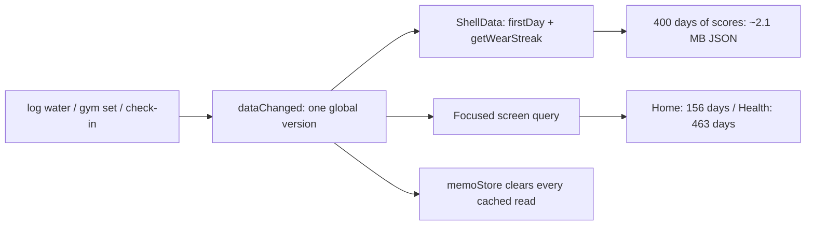
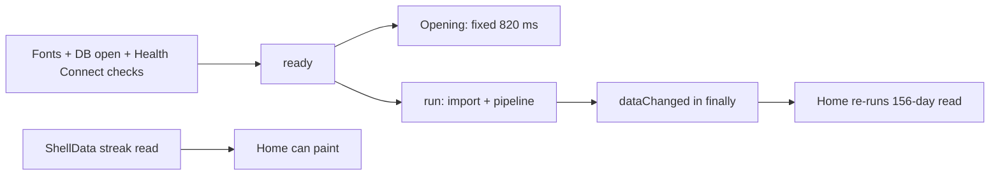

# Snappiness audit, 2026-11-03

Scope: the Android app's cold start, tab/screen loads, and the response to a write (log, check-in, gym set, sync).
The measurements below are the **pre-fix** state. The fixes landed the same day (waves 1–7 of the plan below; the
choices are recorded in `docs/learning.md`), except the refresh-rate cap and the lighter skeleton. After them, on the
same 180-day demo in Node: Home 41 → 22 ms with 19 → 10 store calls, Health 80–203 → 36 ms with 18 → 11, and the wear
streak after a log 25 ms → 0 calls; the launch sync waits for the first screen, skips the pipeline when nothing changed,
and the opening is 180 ms after the first launch. Measurements are from the query layer on Node with the in-memory
store and halo's 180-day demo seed, scored by `runPipeline`, read through `memoStore` exactly as the screens read it.
Phone figures are estimates from those numbers (a low-end Android JS/JSON path is roughly 3–6× slower) and are
labelled as such.

## Headline

1. **Every write invalidates everything.** `dataChanged()` is one global counter. A gym set tick, a water log or a food
   entry clears every cached read and makes the shell re-parse up to 400 days of score JSON (~2.1 MB) for a streak pill
   that did not change. On the phone this is estimated at a few hundred milliseconds of stall per interaction.
2. **A screen load parses 2–10× more JSON than the screen needs.** One score day is ~12 KB of JSON in 16 columns and
   `scoreOf` parses all of them. Home reads three overlapping ranges (156 day-rows) for one page; the Health tab reads
   five ranges, including two 182-day reads (463 day-rows, ~5.5 MB).
3. **The launch sync runs immediately and always rescores.** Boot starts a Health Connect import + pipeline before the
   first screen is interactive, and the pipeline replays its fold even when the sync found nothing new. At the end it
   fires `dataChanged()` even when nothing changed, so Home immediately re-runs its 156-day read.
4. **Home and Sleep cannot paint until the shell's 400-day streak read finishes.** The shell provider has no time zone
   until its database read lands, and both screens gate their content on it.
5. **Every screen older than 60 s re-runs its whole query on focus** (`FRESH_MS`), even if nothing changed, just to
   refresh clock-relative text.
6. **The per-text overhead is on the slow path on exactly the owner's screen width.** Every `<Text>` calls
   `useWindowDimensions()`, parses its class string with regexes, flattens its style and builds a new style array. The
   narrow-phone type scale is active below 402 dp, so at 361 dp every text node that resolves a font size takes the slow
   path.





## Measurements

Command: a scratch Vitest file that seeds the demo, runs the pipeline, wraps the store in `memoStore`, then runs the
same query functions the screens run. Removed after the audit.

| Read (180-day demo) | Store calls | What it reads | Desktop |
|---|---|---|---|
| Home (`getHome` + `getHomeDashboard` + `dashboardKeys`) | 19 | 3 overlapping `scoresIn` ranges: 60 + 66 + 30 days = **156 day-rows** | 41 ms |
| Health hub (`getHealthHub`) | 18 | 36 + 61 + **183** + **182** + 1 days = **463 day-rows** | 80–203 ms |
| Wear streak (`getWearStreak`) | 1 | **400 days** (every stored day) for one integer | 28–74 ms |
| Sleep / Recovery / Strain / Journal / More / Gym | 1–5 | bounded, small | 1–12 ms |
| Trends, one metric | 3 | ~1 year of scores | 32–59 ms |
| Full pipeline, first run | — | stage 1 + stage 2 over 180 days | 2.6–3.1 s |
| Pipeline, no new data | — | checkpoint keys + 14-day replay | 259 ms |

Row size, measured from the same seed:

- `daily_scores`: 180 rows, **12 KB/day**, 2.1 MB total.
- `daily_metrics`: 71 KB; `daily_values` 81 KB; reports 50 KB. Score JSON is the cost, not the other tables.
- The demo has no logged entries; a real logger adds two full `logged_entries` reads per screen load
  (`metricsWithLoggedBody` reads from 0, `loadDays` reads from `from`).

Scaling with history (same query, 180 → 400 days): Health 80 → 92 ms, streak 28 → 67 ms, trends 32 → 59 ms. Home stayed
flat only because its ranges are capped at 30–66 days; it still reads the whole `daily_metrics` table and all log entries
on every version.

Estimated on the phone (3–6× the desktop JSON/JS path): Home **~150–400 ms**, Health **~0.5–1.2 s**, a write
**~0.3–1 s** of reload after the write completes, launch sync **~1.5–4 s** of JS competing with the first interactions.

## The causes, ranked

### 1. One global data version, and the shell listens to it (P0)

`src/state/app.ts` has a single `version`, bumped by `dataChanged()`. `memoStore` (`src/data/memo.ts`) clears its whole
cache when the version moves, and every focused screen re-runs its query (`src/screens/useScreen.ts`).

`src/screens/ShellData.tsx` subscribes to the version unconditionally and re-reads `firstDay` + `getWearStreak` on every
bump. `getWearStreak` (`src/queries/shell.ts:17`) reads `scoresIn(today-400 … today)` and keeps `strain.hrCount` per day.
That is ~2.1 MB of JSON for the demo's 180 days, more with a longer history.

Writes that bump it: every gym set tick, superset link, note, RPE and set add/remove (`src/screens/gym/SessionScreen.tsx`
calls `dataChanged()` in `save`, `tick`, `linkSuperset`, `details`, `removeSet`, `removeExercise`, `addOne`, `move`, …),
every water/food log, every check-in, every dashboard edit. During a workout that is one 400-day read per set.

The same global bump also makes the focused screen re-read its full query. Home is 156 day-rows; Health is 463.

**Fix:** split invalidation by cause. Scores change only when a scoring run ends; logs, journal and gym rows change on
their own writes. Give `memoStore` separate score/log/journal caches, keep the score cache across a water or gym write,
and stop bumping a version the shell cannot use. A per-screen `refresh` reason (scores | logs | journal | gym) is enough.
For the streak, read `json_extract(strain, '$.hrCount')` per day (or maintain a `day, worn` flag on `putScores`) instead
of parsing the whole row.

### 2. Score rows are read wide and read repeatedly (P0)

`src/data/db.ts:213` `scoreOf` parses all 16 JSON columns of `daily_scores` for every day returned, including
`activities`, `detected`, `journal_impact`, `healthspan`, `training`, `hrv_status`, whether or not the caller uses them.
One day is ~12 KB.

`src/queries/common.ts:99` `loadDays(from, to)` always reads:

- `scoresIn({ from, to })` — the only range-limited read;
- `metricsWithLoggedBody(store)` — **all** metrics plus **all** logged entries, then filtered to the range;
- `dailyValues({ from, to })`;
- `loggedEntries(localMidnight(from), MAX)` — every log entry from `from` on.

Home calls `loadDays` twice with different bounds, so the ranges do not hit the memo (keys include the exact args):
`getHome` uses 60 days, `getHomeDashboard` uses 66, and `getStress` adds 30 more. The Health hub reads 35 days, then
`getHealthspan` reads 182 and `getFitness` reads another 182 with a 5-day offset, so they also miss the memo.

**Fix, in order of return:**

1. **Cache parsed days, not ranges.** In `memoStore.scoresIn`, keep a `Map<day, ScoreRow>` for the loaded version (or
   keep loaded intervals) and serve any requested slice from it. Home's 156 rows become 66 parsed days; Health's 463
   become ~183, roughly halving the parse on the two slowest screens with no schema change.
2. **Read narrow.** Add a summary read (`day`, `recovery.value`, `sleep.score`, `strain.hrCount`/`strainPercent`,
   `training_load`, `healthspan`, `fitness`) for the hub, streak and strip, and keep full rows for the detail screens.
   This is the 3–5× cut, and it keeps Health's first paint to a 30-day read instead of six months.
3. **Give `metricsWithLoggedBody` a range** (or split raw metrics from the body overlay). No screen needs every logged
   entry in the app to show one range.
4. Gate the healthspan/fitness 182-day reads behind the section that shows them, or share one read between them.

A cheaper interim step for the hub: compute the Pulse Age from the single stored week and the previous week
(`lastStored` + one or two `scoresIn(day, day)` reads), and render the 6-month Fitness trend after first paint.

### 3. Launch runs the import, the scoring and a full refresh at once (P0)

`src/state/app.ts` boot order:

1. `applyLanguage` (AsyncStorage) → `openStore` (schema + all migrations every open, line 1073) → `startBackground()` →
   `availability()` + `permissionState()` (Health Connect IPC) → ready.
2. `void run()` at line 220 starts the import + full pipeline before the first interaction.
3. `run()` finishes with `dataChanged()` in `finally` even when `r.unchanged` is true, so Home reloads its whole query.
4. The same happens on every return to the foreground after 10 minutes (`RESYNC_AWAY_MS`).

On the phone the pipeline is the expensive part: stage 2 resumes from the checkpoint but still hashes every day's inputs
(`dayKeys`, `src/pipeline/checkpoint.ts:60`) and replays 14 days; the desktop no-change run is 259 ms, so the phone is
likely 1–2 s. All of it is sliced at 12 ms (`src/lib/yield.ts`), which keeps the thread from freezing but leaves only a
few milliseconds per frame for rendering at 60 Hz and less at 120 Hz.

**Fix:**

- Defer `run()` until the opening has handed over and the first screen has painted (or after an idle moment), then run
  it. The user gets a usable Home first.
- Skip the pipeline when `syncHealthConnect` reports `unchanged`, the newest score is today and `intraday_dirty` is empty.
  A cheap `needsScoring(today)` check (max score day, version, dirty table) keeps the day rollover correct.
- Call `dataChanged()` only when the run actually wrote rows (or when dirty days were scored), not in `finally`.
- Reduce `SLICE_MS` below a 120 Hz frame (6–8 ms), or pause the run while a touch/scroll is active and use larger chunks
  when idle.

### 4. The shell read gates the first screen (P1)

`AppProviders` gives the calendar `{ today }` with no time zone. `ShellData` adds `timeZone` only after its effect reads
`firstDay` + `getWearStreak`. `HomeScreen` renders `vm && timeZone ? <Home/> : <HomeSkeleton/>`, and the Sleep screen has
the same gate. So the 400-day streak read is on the critical path to the first meaningful Home frame.

**Fix:** seed the provider's `timeZone` from `useApp(s => s.profile?.timeZone)` (available at boot) and let the streak
arrive separately. The streak pill can show its skeleton; the page should not.

### 5. A 60-second freshness window re-runs whole screens (P1)

`src/screens/useScreen.ts:31` `FRESH_MS = 60_000` and `fresh()` ties freshness to the global version and the clock. Any
tab focus after a minute re-runs the whole query. The stated reason is clock-relative copy ("today", "11m ago"), but the
live heart rate has its own store (`src/state/liveHr.tsx`) and `today` only changes at midnight.

**Fix:** default freshness to 5–10 minutes, or make it per screen (`opts.freshMs`); update the few clock-relative labels
from their own subscription. This removes most of the "switch back to a tab and it stutters" behaviour.

### 6. Every `<Text>` is expensive, and the owner's width takes the slow path (P1)

`src/ui/Text.tsx:28`:

- `useWindowDimensions()` per text node (a Dimensions subscription per node);
- `readFont(className)` splits the class string and runs three regexes per render;
- `hasColorClass(rest)` runs a large colour regex per render;
- `StyleSheet.flatten(style)` plus a new `[style, scaled, transform]` array per render when the scale is active;
- two nested context providers per node.

At a 361 dp window `typeScale(361) ≈ 0.922`, so every text node that resolves a font size on the owner's phone builds the
scaled style; none of those take the `if (!scaled && !shift) return <RNText …>` fast path. A Home page has hundreds of text nodes; the first mount
and each full re-render pay this per node.

**Fix:** one `TypeScaleProvider` at the root (one Dimensions subscription), a `Map` cache for `readFont`/`hasColorClass`
keyed by class string, and `useMemo` for the style array and transform. This is a central, low-risk change that helps
every screen.

### 7. Boot does optional work before the first frame (P1/P2)

At boot, `AppProviders` mounts `LiveBleProvider` and `LeFuScaleProvider`; both call `start()` immediately, and both read
their AsyncStorage keys and create a `new BleManager()` (`src/health/ble.ts:320`, `src/health/lefuBle.ts:296`), even if
the person never opens Live heart rate or the scale. `startBackground()` also installs the notification handler, reads
settings, syncs the task registration and schedules the check-in; `checkForUpdate()` may parse the cached release; and
`initLeetCode` reads its snapshot. None of this is needed before the first screen.

**Fix:** start BLE on the first use of its screen (the provider can keep the context but not the controller), and move
`startBackground`, the update check and LeetCode to `requestIdleCallback`/`InteractionManager.runAfterInteractions` after
the first paint. Keep the foreground sync and the notification deep-link listeners, which are needed for correctness.

### 8. The opening is a fixed 820 ms on every launch (P2, product)

`src/screens/Opening.tsx`: the overlay fades at 520 ms and ends at 820 ms after ready. On a cold start that is added to
the splash time; the app underneath is loading, so it hides some of the wait, but the user cannot interact until it is
gone. A warm start pays it too.

**Fix:** keep the full beat on the first launch after install/update (or once a day) and use a ~300 ms fade on later
launches; or let the first tap dismiss the overlay immediately.

### 9. Drawing and frame budget on a low-end 120 Hz phone (P2)

- `plugins/withHighRefreshRate.js` asks for the panel's **highest** mode. On a mid/low-end phone with a 120 Hz panel that
  halves the frame budget and makes the same draw cost more likely to miss. A 60/90 Hz cap, a Settings toggle, or a
  device-tier check would give a steadier result.
- Home mounts three Skia canvases (`StrainRecoveryChart`, `StressChart`, `EnergyBankChart`) plus three SVG dials; Skia's
  native library (10.8 MB) loads when Home first mounts. Health mounts the Pulse Age orb, up to 640 SVG circles across a
  few layers.
- `useScreen` keeps up to 100 cached results; the two biggest are Home (8 KB) and Health (21 KB) of *JSON*, but the live
  object graph is larger. Not the headline, but a byte budget is safer than 100 entries on a 3–4 GB phone.
- The skeleton and the real page are two full trees: the skeleton mounts, then Home mounts. On a slow phone that is a
  visible double cost; a lighter skeleton, or reusing the shell, would cut it.

## What is already good

Do not undo these while fixing the above:

- `removeClippedSubviews` on the scroll containers and the detail wrappers, which keeps the first draw to what is on
  screen (`docs/learning.md`, "Long pages and the first draw").
- `keepEqual` (`src/screens/keepEqual.ts`) + the React Compiler: a reload that changes one tile keeps the other tiles'
  objects, so only the changed components render.
- Query deferral until the native `transitionEnd` event, per-screen caching, `enableFreeze(true)`, and `startTransition`
  for bodies that mount out of view.
- WAL + `synchronous=normal`, batched transactions, bucketed samples instead of one row per reading, R8 + resource
  shrinking, Hermes, the per-icon lucide Babel plugin, and the svg bitmap patch.
- Sleep, Recovery, Strain, Journal, More and Gym queries are 1–12 ms on the desktop; they are not the problem. The cost
  is concentrated in Home, Health and the shell.

## Suggested order of work

| Wave | Change | Expected effect | Risk |
|---|---|---|---|
| 1 | Per-day score cache in `memoStore`; range-aware `metricsWithLoggedBody` | Home 156 → 66 parsed days, Health 463 → ~183 | low, contained |
| 2 | Split invalidation (scores vs logs/gym/journal) + streak from a light read | removes a 400-day parse per log/set/check-in | medium, needs care |
| 3 | Don't gate Home/Sleep on `ShellData`; seed the profile zone | first Home frame ~100–300 ms earlier on a phone | low |
| 4 | Defer launch sync, skip scoring when unchanged, don't `dataChanged` on a no-op run | removes 1–2 s of competing work at launch | medium |
| 5 | `FRESH_MS` per screen (5–10 min default) | removes whole-screen reloads on tab focus | low |
| 6 | `TypeScaleProvider` + class parsing caches + memoized text styles | cheaper mount/rerender on 361 dp | low-medium, touches every screen |
| 7 | Defer BLE/background/update/LeetCode; shorter opening on warm starts | 200–500 ms off cold start | low |
| 8 | Refresh-rate cap / low-end mode; lighter health orb/skeleton | steadier frames on low-end hardware | product decision |

## How to verify on the phone

Measure the **release/preview APK**, not a Metro development build: dev JS is unminified and dev-mode React is much
slower, which alone can explain a "slow" impression.

```sh
# cold start, release build
adb shell am force-stop in.portlabs.pulse
adb shell am start -W -n in.portlabs.pulse/.MainActivity

# frame deadlines while scrolling / switching tabs
adb shell dumpsys gfxinfo in.portlabs.pulse reset
# … use the app …
adb shell dumpsys gfxinfo in.portlabs.pulse | sed -n '/Janky frames/,+6p'

# a trace when a screen or the sync stutters (Perfetto)
# then look at the long Choreographer#doFrame slices and Record View#draw
```

The app already logs query times in development (`[screen] <key> loaded ms=…`) and transition gaps
(`[screen] … transition-end … js-gaps=…`). Those two lines distinguish "the query is slow" from "the render/draw is slow"
without guessing.
