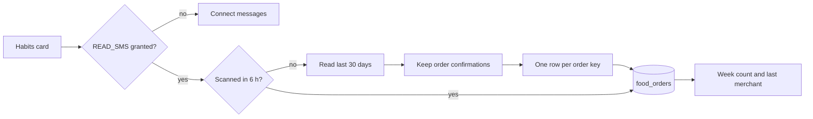

# Food orders from SMS

Pulse counts online food orders from the confirmation messages the delivery apps send. The count appears on Habits as
the **Food orders** card: this week's count and the last merchant. It is Pulse-only local data: no health source, no
account, no server.

## What is read, and what is kept

`READ_SMS` lets the native reader query the inbox. The scan reads the last 30 days and opens only the confirmation texts.
A message becomes an order only when it carries an order phrase ("order placed", "has received your … order", "order
confirmed") **and** a merchant. The parser rejects OTPs, cancellations, refunds, payments, delivery updates and adverts.

Only the merchant, the local day, the message timestamp, the sender and a dedupe key are stored. **The message body is
never stored and never leaves the phone.** There is no LLM call in this path: the rules run locally, so the feature works
offline, costs nothing and keeps the inbox private. An LLM fallback for unknown senders can be added later only behind an
explicit opt-in.

`src/core/food/orders.ts` is the pure parser and its sample tests. The native reader is the local Expo module
`modules/pulse-sms` (Kotlin, `content://sms/inbox`). The permission request and the scan live in
`src/actions/foodOrders.ts`; the writes (and their dedupe) in `src/actions/foodOrderStore.ts`.

## Dedupe

One order sends several texts. The parser extracts the order id or the link's order token when the message has one; both
the first confirmation and its follow-up map to the same `key`. Without either, merchant + day + hour is the key. A
follow-up with the same key is ignored, so a day's count is orders, not messages.

## When it scans

Habits opens the card with the stored orders. If `READ_SMS` is already granted and the last scan is over six hours old,
the card scans in the background; otherwise it waits. The card's **Scan** button asks for the permission (one Android
dialog) and scans on demand. A denial leaves the card in its "Connect messages" state; nothing else changes.

## Limits

- Google Play restricts `READ_SMS` to the default SMS app. Pulse is sideloaded via pugg, so the permission is granted in
  Android's own settings; a Play Store release would need a different source (notification access or a share import).
- A sender that changes its wording can be missed; a known brand named in a promo can be a false positive. The card shows
  the last merchant and the day, so a wrong row is visible.
- The 30-day window is deliberate: enough to see a pattern, short enough not to scan a mailbox forever.
- A force-stopped app does not scan until it is opened again; there is no background SMS poll.

